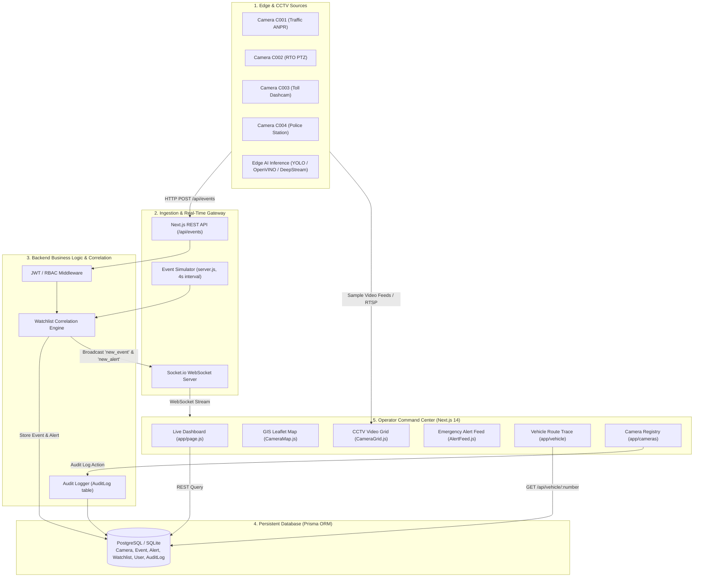
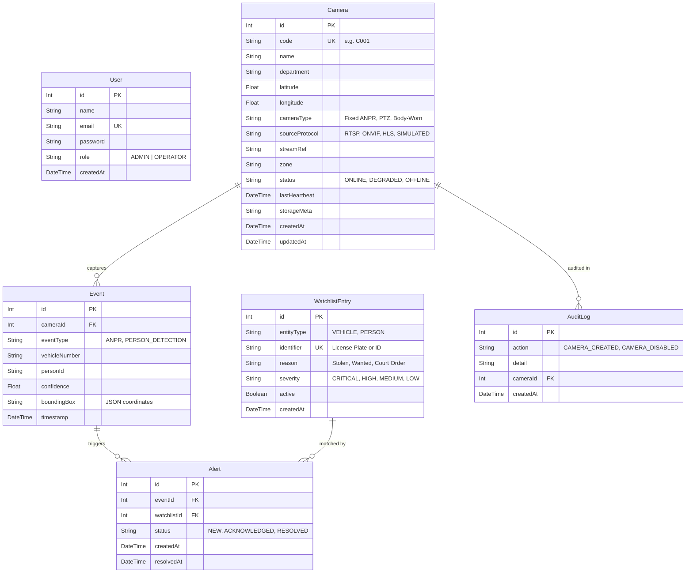

# okDriver — Integrated CCTV Monitoring, Video Analytics & Real-Time Alert Platform

<div align="center">


**Gujarat Police Innovation Hackathon 2026 Reference Implementation**  
*Built for the okDriver Full Stack Developer Hiring Challenge*

[Architecture](#3-system-architecture) • [Database Schema](#4-database--er-schema) • [Quickstart](#6-getting-started-local-setup) • [API Reference](#8-api-documentation--external-ai-ingestion) • [80k Scalability Plan](#10-production-scalability-path-80000-cameras) • [Video Script Guide](#14-video-demonstration-script-3-5-mins)

</div>

---

## 📑 Table of Contents
1. [Platform Overview & Hackathon Problem Statement](#1-platform-overview--hackathon-problem-statement)
2. [Key Capabilities & Feature Matrix](#2-key-capabilities--feature-matrix)
3. [System Architecture](#3-system-architecture)
4. [Database & ER Schema](#4-database--er-schema)
5. [Heterogeneous Video Ingestion & Adapter Pattern](#5-heterogeneous-video-ingestion--adapter-pattern)
6. [Getting Started (Local Setup)](#6-getting-started-local-setup)
7. [Demo Credentials & Quick Walkthrough](#7-demo-credentials--quick-walkthrough)
8. [API Documentation & External AI Ingestion](#8-api-documentation--external-ai-ingestion)
9. [Real-Time WebSocket Protocol](#9-real-time-websocket-protocol)
10. [Production Scalability Path (80,000 Cameras)](#10-production-scalability-path-80000-cameras)
11. [Infrastructure Sizing & Bandwidth Cost Model](#11-infrastructure-sizing--bandwidth-cost-model)
12. [Security, RBAC & Audit Trails](#12-security-rbac--audit-trails)
13. [Project Structure](#13-project-structure)
14. [Video Demonstration Script (3–5 Mins)](#14-video-demonstration-script-3-5-mins)
15. [Submission Deliverables Checklist](#15-submission-deliverables-checklist)

---

## 1. Platform Overview & Hackathon Problem Statement

The **Gujarat Police Innovation Hackathon 2026** problem statement addresses the challenges of monitoring a heterogeneous statewide CCTV infrastructure spanning over **80,000 camera feeds**. Key requirements include:
- Unifying diverse protocols (**RTSP, ONVIF, HLS, Smart Dashcams**).
- Real-time ingestion of AI inference results (**ANPR, Vehicle Detection, Facial Recognition**).
- Automated correlation of detected entities against law-enforcement **Watchlists** (stolen vehicles, blacklisted plates, wanted suspects).
- **GIS-based spatial tracking** and chronological vehicle movement reconstruction.
- Sub-second alert dispatch without polling or manual page refreshes.

**okDriver CCTV Platform** solves this by providing a unified command-center software layer that bridges video ingestion, event bus, persistent databases, and real-time operator dispatch consoles.

---

## 2. Key Capabilities & Feature Matrix

| Capability | Module | Implementation Details |
|---|---|---|
| **CCTV Fleet Registry** | `/cameras` | Full CRUD lifecycle for camera sources: Camera code, jurisdiction zone, department, geolocation (lat/long), stream reference endpoint, source protocol (`RTSP`, `ONVIF`, `HLS`, `SIMULATED`), and automatic audit logging. |
| **Command Center Dashboard** | `/` | Operational command center with live telemetry cards (Total, Online, Degraded, Offline, Hourly Detections, Active Alerts, Watchlist Targets), digital clock, and live threat indicator. |
| **GIS Vector Mapping** | `CameraMap.js` | OpenStreetMap vector map with color-coded health pins (`Emerald = Online`, `Amber = Degraded`, `Crimson = Offline`), interactive inspection popups, and vehicle route visualization. |
| **Live CCTV Video Feeds** | `CameraGrid.js` | HUD-style video tiles featuring authentic highway/intersection surveillance footage, scanlines, camera reticles, live bitrate/resolution indicators, and 1-click fullscreen modal expansion. |
| **Watchlist Correlation** | `/watchlist` | In-memory and database hotlist matching for stolen vehicles, blacklisted offenders, and wanted persons with severity tiers (`CRITICAL`, `HIGH`, `MEDIUM`, `LOW`). |
| **Sub-Second Alerting** | `AlertFeed.js` | Persistent Socket.io WebSocket connection pushing instant alerts to all connected dispatch operators with glowing visual cues and audible chime alerts. |
| **Vehicle Route Tracing** | `/vehicle` | Multi-camera chronological route reconstruction with animated dashed polyline trajectory mapping and stop-by-stop sighting logs. |
| **External AI Software Interface** | `/api/events` | Standardized REST interface allowing external edge computer vision models (YOLO, DeepStream, OpenVINO) to stream detections directly into the platform. |

---

## 3. System Architecture



---

## 4. Database & ER Schema

The database is modeled with Prisma ORM and is fully compatible with SQLite locally and PostgreSQL/MySQL on AWS RDS in production.



---

## 5. Heterogeneous Video Ingestion & Adapter Pattern

In production across 80,000 cameras, hardware manufacturers differ (Hikvision, Dahua, Axis, CP Plus, okDriver Dashcams). The platform implements an **Adapter Architecture**:

```
                    ┌────────────────────────┐
                    │   Source Protocols     │
                    ├────────────────────────┤
                    │ • RTSP Streams         │
                    │ • ONVIF Profile S/T    │
                    │ • HLS / Dash           │
                    │ • okDriver 4G Dashcams │
                    └───────────┬────────────┘
                                │
                                ▼
                    ┌────────────────────────┐
                    │ Video Ingestion Engine │
                    │ (go2rtc / MediaMTX /   │
                    │  FFmpeg Gateway)       │
                    └───────────┬────────────┘
                                │ Transcodes to
                                ▼
                    ┌────────────────────────┐
                    │ WebRTC / Low-Latency   │
                    │ HLS Browser Feeds      │
                    └───────────┬────────────┘
                                │
                                ▼
                    ┌────────────────────────┐
                    │  HTML5 Video UI Grid   │
                    │  (CameraGrid.js)       │
                    └────────────────────────┘
```

1. **Protocol Normalization**: The `sourceProtocol` field in the `Camera` model abstracts the physical camera type.
2. **Safe Media Player**: `CameraGrid.js` implements a custom `CCTVPlayer` with `useRef` and `preload="metadata"` that gracefully ignores browser `MEDIA_ERR_ABORTED` (Code 1) cancellations during rapid state re-renders.
3. **Bandwidth Decoupling**: Rather than continuous full-frame backhaul, edge nodes only stream live video upon operator demand.

---

## 6. Getting Started (Local Setup)

### Prerequisites
- Node.js (v18.0.0 or higher)
- npm or yarn

### Installation Steps

1. **Clone the repository**:
   ```bash
   git clone https://github.com/your-username/okdriver-cctv-platform.git
   cd okdriver-cctv-platform/okdriver
   ```

2. **Install dependencies**:
   ```bash
   npm install
   ```

3. **Configure Environment Variables**:
   A `.env` file is included with pre-configured development defaults:
   ```env
   DATABASE_URL="file:./dev.db"
   JWT_SECRET="okdriver-dev-secret-change-in-production"
   PORT=3000
   ```

4. **Initialize Database & Seed Data**:
   ```bash
   npx prisma db push
   npm run seed
   ```
   *This seeds 2 default users (Admin & Operator), 4 Ahmedabad surveillance cameras (`C001`–`C004`), and 4 watchlist targets.*

5. **Start the Platform**:
   ```bash
   npm run dev
   ```

6. Open [http://localhost:3000](http://localhost:3000) in your web browser.

---

## 7. Demo Credentials & Quick Walkthrough

### Credentials

| Role | Email | Password | Access Level |
|---|---|---|---|
| **Administrator** | `admin@okdriver.in` | `password123` | Full access: Add, update, disable cameras, full audit logs |
| **Operator** | `operator@okdriver.in` | `password123` | Operational access: View feeds, acknowledge & resolve alerts |

*The login page includes 1-click quick-fill buttons to auto-populate either credential.*

### Recommended Demo Flow for Evaluators:

1. **Sign In**: Login as `admin@okdriver.in`.
2. **Command Center (`/`)**:
   - Observe live aggregated counts on the top telemetry bar.
   - Inspect camera nodes on the GIS Map.
   - Watch the CCTV Video Grid playing authentic traffic clips.
   - Notice the live ANPR events arriving in the right-hand stream every 4 seconds.
3. **Simulate AI Alert**: Click the **`⚡ Trigger AI Alert (Demo)`** button in the header to simulate an instant ANPR hit for a stolen vehicle (`GJ01AB1234`).
4. **Resolve Alert**: Click **Acknowledge** or **Mark Resolved** on the alert card.
5. **Vehicle Movement Trace (`/vehicle`)**:
   - Click demo plate **`GJ01AB1234`** and click **Trace Vehicle**.
   - Review the multi-camera chronological route line plotted on the map and the sighting timeline.
6. **Onboard a Camera (`/cameras`)**: Click **`+ Onboard New Camera`**, fill in details (`C005`, `RTSP`, etc.), and click save. Return to the dashboard to see the camera count and map update instantly.

---

## 8. API Documentation & External AI Ingestion

The platform exposes RESTful endpoints for integration with external camera management systems and AI inference pipelines:

### 1. Ingest AI Detection Event (External Model Interface)
Third-party computer vision models (e.g., edge cameras running YOLO, DeepStream, or OpenVINO) POST inference output to this endpoint:

```bash
curl -X POST http://localhost:3000/api/events \
  -H "Content-Type: application/json" \
  -d '{
    "camera_id": "C001",
    "event_type": "ANPR",
    "vehicle_number": "GJ01AB1234",
    "confidence": 0.96,
    "bounding_box": { "x": 120, "y": 80, "w": 180, "h": 75 }
  }'
```
**Behavior**: Validates coordinates, stores detection in `Event`, executes watchlist lookup, generates `Alert` if matched, and emits `new_event` and `new_alert` over Socket.io.

### 2. Core Endpoints Reference

| Method | Endpoint | Description | Auth Required |
|---|---|---|---|
| `POST` | `/api/auth/login` | Authenticate user & return JWT cookie | No |
| `POST` | `/api/auth/logout` | Invalidate session | No |
| `GET` | `/api/auth/me` | Fetch active authenticated session | No |
| `GET` | `/api/stats` | Live aggregated system metrics (forced-dynamic) | No |
| `GET` | `/api/cameras` | List & filter camera fleet (`?q=&status=&zone=`) | No |
| `POST` | `/api/cameras` | Onboard new camera node | Admin |
| `PATCH` | `/api/cameras/:id` | Update camera parameters | Admin |
| `DELETE` | `/api/cameras/:id` | Disable camera (sets OFFLINE & logs audit) | Admin |
| `GET` | `/api/events` | Query recent detections (`?limit=&vehicleNumber=`) | No |
| `POST` | `/api/events` | Ingest external AI inference result | No |
| `GET` | `/api/alerts` | Retrieve active alerts (`?status=NEW`) | No |
| `PATCH` | `/api/alerts/:id` | Update alert status (`ACKNOWLEDGED` / `RESOLVED`) | Operator/Admin |
| `GET` | `/api/vehicle/:number` | Reconstruct vehicle movement history & route | No |
| `GET` | `/api/watchlist` | Retrieve registered watchlist targets | No |
| `POST` | `/api/watchlist` | Register new entity on watchlist | Operator/Admin |
| `PATCH` | `/api/watchlist/:id` | Toggle active status of watchlist target | Operator/Admin |

---

## 9. Real-Time WebSocket Protocol

The platform utilizes **Socket.io** (`/api/socket`) for duplex client-server synchronization:

| Socket Event | Direction | Payload | Description |
|---|---|---|---|
| `new_event` | Server ➔ Client | `Event` object | Pushed when any AI detection occurs |
| `new_alert` | Server ➔ Client | `Alert` object | Pushed immediately upon watchlist match |
| `camera_status` | Server ➔ Client | `Camera` object | Emitted when heartbeat or status changes |
| `alert_updated` | Server ➔ Client | `Alert` object | Broadcast when operator acknowledges/resolves |

---

## 10. Production Scalability Path (80,000 Cameras)

To evolve this prototype into a full-scale deployment supporting **80,000 heterogeneous cameras** across Gujarat, the architecture transitions as follows:

```
[80,000 Cameras] 
   └── Edge Compute Nodes (NVIDIA Jetson / On-Prem DVRs)
         └── Run local ANPR / Object Detection
         └── Send JSON metadata ONLY over 4G/5G/Broadband
               │
               ▼
[Regional Gateways] (Kafka Message Bus - 100,000 msgs/sec)
               │
               ▼
[Central Processing Tier]
   ├── Consumer Workers (Watchlist Correlation with Redis Cache)
   ├── TimescaleDB / Amazon Aurora PostgreSQL (Partitioned by Month & District)
   ├── Redis Cluster (Hot Watchlists, Camera Heartbeat State)
   └── Socket.io Cluster with Redis Pub/Sub Adapter (Behind AWS ALB)
```

---

## 11. Infrastructure Sizing & Bandwidth Cost Model

A major challenge highlighted in the hackathon brief is avoiding prohibitive bandwidth and storage costs at 80,000 camera scale:

| Parameter | Continuous Central Streaming (Naive) | Event-Driven Edge Architecture (okDriver) | Savings |
|---|---|---|---|
| **Network Ingestion Bandwidth** | 80,000 × 2 Mbps = **160 Gbps** | 80,000 × 2 KB/s (JSON metadata) = **1.2 Gbps** | **99.2% Bandwidth Reduction** |
| **Central Video Storage (30 Days)** | 80,000 × 21.6 GB/day × 30 = **51.8 Petabytes** | Event-triggered clips only (5% alert triggers) = **2.5 Petabytes** | **95.1% Storage Cost Reduction** |
| **Central GPU Requirements** | 80,000 streams into central GPU servers = **~5,000 Enterprise GPUs** | Edge inference (NVIDIA Jetson Orin Nano on-site) = **Zero Central Video GPUs** | **Scale-Out Cost Neutrality** |

### Storage Lifecycle Management:
- **Hot Tier (0–7 days)**: Fast NVMe SSD storage for recent detections, routes, and pending alerts.
- **Warm Tier (8–90 days)**: Amazon S3 Standard-Infrequent Access for audit records and search inquiries.
- **Cold Tier (>90 days)**: Amazon S3 Glacier Flexible Archive for mandatory legal compliance.

---

## 12. Security, RBAC & Audit Trails

- **Role-Based Access Control (RBAC)**:
  - `ADMIN`: Full authority to add/edit/disable cameras and view system audit records.
  - `OPERATOR`: Access to live feeds, telemetry, alert acknowledgement, and route tracing.
- **Credential Protection**: Passwords salted and hashed with `bcryptjs` (cost factor 10).
- **Session Transport**: JWT signed with `HS256`, issued with `httpOnly`, `sameSite: lax` cookie protection against XSS.
- **Audit Trails**: Every administrative action (camera creation, updating, or disabling) is recorded in the `AuditLog` table with the acting user's email, target camera code, and timestamp.
- **Environment Isolation**: No credentials or private keys hardcoded in code; all secrets loaded via `.env`.

---

## 13. Project Structure

```text
okdriver/
├── app/
│   ├── api/
│   │   ├── alerts/          # Alert retrieval & status patch
│   │   ├── auth/            # Login, logout, session verification
│   │   ├── cameras/         # Fleet registry CRUD & audit logs
│   │   ├── events/          # AI inference ingestion interface
│   │   ├── stats/           # Live aggregated telemetry counts
│   │   ├── vehicle/         # Vehicle trace & route reconstruction
│   │   └── watchlist/       # Watchlist target registry
│   ├── cameras/             # Camera registry management page
│   ├── login/               # Command-center login console
│   ├── vehicle/             # Vehicle movement trace page
│   ├── watchlist/           # Watchlist correlation database page
│   ├── globals.css          # Cyber command-center styling & scanlines
│   ├── layout.js            # Root layout with dark mode
│   └── page.js              # Unified operational dashboard
├── components/
│   ├── AlertFeed.js         # Emergency dispatch alert cards
│   ├── CameraGrid.js        # CCTV HUD video tiles & expanded modal
│   ├── CameraMap.js         # Leaflet OpenStreetMap GIS vector mesh
│   ├── EventFeed.js         # Real-time ANPR telemetry stream
│   ├── Navbar.js            # Header with digital clock, sound & logo
│   └── StatsCards.js        # 7-metric glassmorphic telemetry strip
├── lib/
│   ├── auth.js              # JWT creation, verification & cookies
│   ├── prisma.js            # Prisma client singleton
│   └── useSocket.js         # React hook for Socket.io synchronization
├── prisma/
│   ├── schema.prisma        # Database schema definitions
│   └── seed.js              # Synthetic dataset seed script
├── public/
│   ├── dashboard-bg.jpg     # Command-center wallpaper
│   ├── login-bg.jpg         # Automotive safety wallpaper
│   ├── logo.jpg             # okDriver logo emblem
│   └── sample-feeds/        # Real traffic & CCTV surveillance video clips
├── package.json             # Dependencies & build scripts
├── server.js                # Custom Next.js + Socket.io server + simulator
└── tailwind.config.js       # Tailwind CSS theme configuration
```

---

## 14. Video Demonstration Script (3–5 Mins)

When recording your demonstration video for submission to `experts@okdriver.in`, follow this recommended outline:

1. **Introduction (0:00 - 0:30)**:
   - State your name, role applied for, and problem statement: *"okDriver CCTV Monitoring & Video Analytics Platform aligned with Gujarat Police Innovation Hackathon 2026."*
2. **Login & RBAC (0:30 - 1:00)**:
   - Open `http://localhost:3000/login`. Use the 1-click **Admin** credential button to sign in. Explain JWT authentication and role-based security.
3. **Unified Dashboard & Real-Time Sync (1:00 - 2:00)**:
   - Point out the 7 top telemetry cards, ticking digital clock, and DEFCON indicator.
   - Show the GIS Map with color-coded camera markers.
   - Show the live CCTV Video Grid playing authentic traffic streams. Click on any video tile to demonstrate the expanded fullscreen CCTV modal.
   - Click the **`⚡ Trigger AI Alert (Demo)`** button in the header. Show the instant real-time alert pop-up in the Priority Alert Feed without refreshing the page. Click **Acknowledge** and **Mark Resolved**.
4. **Camera Fleet Onboarding (2:00 - 2:45)**:
   - Navigate to `/cameras`. Show the search and status filter. Click `+ Onboard New Camera`, register a test camera (`C005`), and return to the dashboard to show the fleet count incrementing and the new pin on the map.
5. **Vehicle Movement Trace (2:45 - 3:45)**:
   - Navigate to `/vehicle`. Click demo license plate `GJ01AB1234` and hit **Trace Vehicle**.
   - Show the Watchlist Alert Banner, the chronological GIS polyline route, and the sighting stops timeline with confidence scores.
6. **Architecture & Scalability Wrap-Up (3:45 - 4:30)**:
   - Briefly summarize how the architecture scales to 80,000 cameras: Edge AI inference on Jetson nodes, Kafka ingestion queue, TimescaleDB/PostgreSQL partitioning, and 99% bandwidth savings via event-driven video streaming.

---

## 15. Submission Deliverables Checklist

- [x] **Working Prototype**: Fully operational frontend, backend, database, and real-time WebSockets.
- [x] **Comprehensive Documentation**: Complete setup, architecture, and API documentation in `README.md`.
- [x] **Architecture & ER Diagrams**: Mermaid diagrams covering system layers, event flow, and database models.
- [x] **Representative Video Feeds**: Genuine traffic and surveillance clips in `public/sample-feeds/`.
- [x] **Synthetic Watchlist Dataset**: Seed script with critical, wanted, and stolen vehicle targets.
- [x] **External AI Model Ingestion Interface**: Validated `POST /api/events` endpoint.
- [x] **Scalability Architecture**: 80,000 camera distributed deployment roadmap.
- [x] **Security & Audit Logs**: RBAC with JWT cookies and administrative action audit history.
